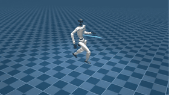
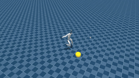
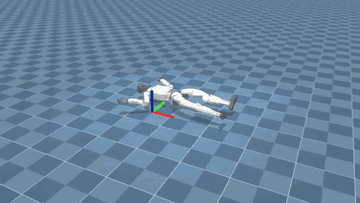
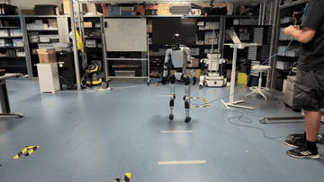

# Learning Reusable Hybrid Motion Priors for Humanoid Locomotion from Motion Imitation

Code for the paper *Learning Reusable Hybrid Motion Priors for Humanoid
Locomotion from Motion Imitation* (arXiv:2607.24083). Project page:
<https://hucebot.github.io/hmp-project/>.

<p align="center">
  
  
  
  
</p>

The pipeline turns motion-imitation skills into a reusable **hybrid motion
prior (HMP)** for the Unitree G1, in three stages:

| Phase | Task ID | What is trained |
|---|---|---|
| I. Motion-imitation expert | `Mjlab-HMP-EncDec-Unitree-G1` | PPO expert tracking retargeted LaFAN clips |
| II. HMP distillation | `Mjlab-HMP-Imitation-Unitree-G1` | Proprioceptive encoder + RVQ codebook + action decoder, distilled from the frozen expert |
| III. Velocity tracking | `Mjlab-HMP-Locomotion-Unitree-G1` | Task-level code-selection policy on the frozen HMP |
| III. Point-goal navigation | `Mjlab-HMP-Navigation-Unitree-G1` | Same, goal-reaching command |
| III. Fall-recovery velocity tracking | `Mjlab-HMP-Recovery-Unitree-G1` | Same, falling is recoverable |

Training is built on [`mjlab`](https://github.com/mujocolab/mjlab) 1.2.0.

## Installation

Install [`uv`](https://docs.astral.sh/uv/), then:

```bash
uv sync
uv run list_envs | grep HMP
```

## Motion data

The expert learns from LaFAN motion-capture clips retargeted to the G1
([LAFAN-G1](https://huggingface.co/datasets/ember-lab-berkeley/LAFAN-G1)). The
dataset covers locomotion, dancing, falls and other everyday motions; the
paper uses a subset of locomotion and fall-and-get-up clips.

Download LAFAN-G1, convert it to the format used here and put the clips you
want to train on in `assets/motions/g1_lafan_recovery/`:

```bash
uv run python scripts/convert_lafan_g1.py \
  --input-dir <LAFAN-G1 download>/ --output-dir assets/motions/g1_lafan_recovery
```

Keep some fall-and-get-up clips in the set: the HMP needs them to learn to get
up, and the fall-recovery task starts part of its episodes from their poses.
The motion folder used by Phases I and II is set in
[`src/hmp/config/g1/motion_data_cfg.yaml`](src/hmp/config/g1/motion_data_cfg.yaml).

## Training

Each stage consumes the checkpoint of the previous one. Commands use the
paper settings (8192 envs for Phases I-II, 4096 for Phase III).

```bash
# Phase I: motion-imitation expert (30k iterations)
uv run train Mjlab-HMP-EncDec-Unitree-G1 --env.scene.num-envs 8192

# Phase II: distill the expert into the HMP (6k iterations)
uv run train Mjlab-HMP-Imitation-Unitree-G1 --env.scene.num-envs 8192 \
  --agent.expert-checkpoint logs/rsl_rl/g1_hmp_encdec/<run>/model_29999.pt

# Phase III: task-level policies on the frozen HMP
HMP=logs/rsl_rl/g1_hmp_imitation/<run>/model_6000.pt
uv run train Mjlab-HMP-Locomotion-Unitree-G1 --env.scene.num-envs 4096 \
  --agent.imitation-checkpoint-file $HMP          # 4.5k iterations
uv run train Mjlab-HMP-Navigation-Unitree-G1 --env.scene.num-envs 4096 \
  --agent.imitation-checkpoint-file $HMP          # 5.5k iterations
uv run train Mjlab-HMP-Recovery-Unitree-G1 --env.scene.num-envs 4096 \
  --agent.imitation-checkpoint-file $HMP          # 9k iterations
```

Useful options:

- `--agent.rvq-num-active-quantizers M` trains a Phase III policy that drives
  only the first `M` RVQ stages (active RVQ depth, Sec. V-B).
- `--agent.rvq-rotation-trick False` distills the HMP with the standard
  straight-through estimator instead of the rotation trick (Sec. V-C).
- `--agent.imitation-wandb-run-path entity/project/run_id` resolves the HMP
  checkpoint from W&B instead of a local file.

## Play

```bash
uv run hmp-play Mjlab-HMP-Locomotion-Unitree-G1 \
  --checkpoint-file logs/rsl_rl/g1_hmp_locomotion/<run>/model_4499.pt \
  --imitation-checkpoint-file $HMP
```

Phase III policies are exported to ONNX next to every checkpoint; the exported
model maps the actor observation to joint-position targets (argmax code
selection followed by the frozen HMP). To export an existing checkpoint:

```bash
uv run python -m hmp.scripts.deploy.export_checkpoint_to_onnx --help
```

## Development

```bash
uv sync --group dev
make format
```

## Citation

```bibtex
@article{belli2026hmp,
  title   = {Learning Reusable Hybrid Motion Priors for Humanoid Locomotion from Motion Imitation},
  author  = {Belli, Valerio and Modugno, Valerio and Mingo Hoffman, Enrico and Amadio, Fabio},
  journal = {arXiv preprint arXiv:2607.24083},
  year    = {2026}
}
```
